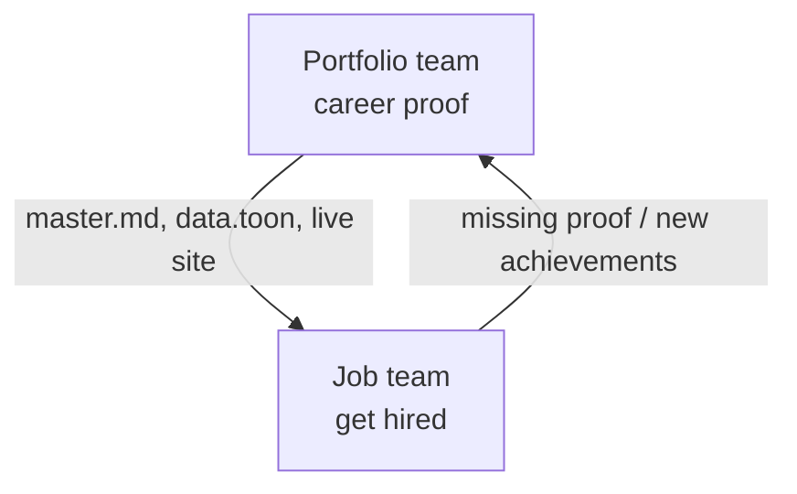
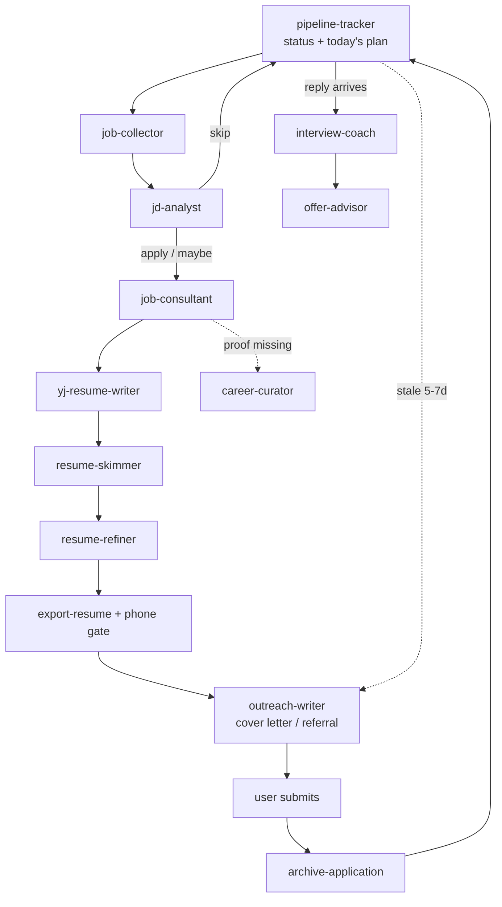

# Teams (this repo overrides the global iOS team table)

Claude is the Manager. The user sets direction; Claude briefs agents and never lets a subagent self-assign.
`ios-developer`, `cs`, `reporter`, `designer`, `tester`, `marketer` from the global config do NOT apply here.
Implementation of the site goes to `fe-developer`. Repo rules: `AGENTS.md`.

Goal of the whole repo: **get 이영준 hired.** The portfolio team builds the proof; the job team uses it.

## Team A: Portfolio (career)

Owns the asset base. Everything a resume or recruiter reads comes from here.

| Agent | Owns |
|-------|------|
| `career-curator` | `data.toon`, `companies/*.toon`, Notion↔TOON sync, `master.md` bullet bank, fact-check, privacy sweep |
| `fe-developer` | `src/`, CSS, i18n, Vite, loaders, `npm run build`, layout checks |
| `technical-article-writer` (global) | blog posts / articles when asked |
| skills: `deploy`, `add-application` | publish site, add archived application to the site |

Rules: facts exact; content changes go in TOON, not JSX; no phone numbers anywhere; `dist/` is never edited; deploy only on the user's word.

## Team B: Job (get hired)

Does whatever raises the odds of an offer. Daily-apply plan and exclusions live in memory `project_job_search_2026_10.md`.

| Agent | Role |
|-------|------|
| `pipeline-tracker` | single status board: every company, stage, next action, follow-up date, unverified items; owns `application-history/README.md` |
| `job-collector` | find postings (Wanted/Saramin/Jumpit), save `jd.md` |
| `jd-analyst` | fit verdict, base ①/②, gaps |
| `job-consultant` | directs ONE application to submit-ready; pre-apply gate |
| `resume-refiner` | minimal edits from skim feedback |
| `outreach-writer` | company research, cover letter/자소서, recruiter/referral/headhunter messages, follow-ups |
| `interview-coach` | Q&A, STAR, questions to ask |
| `offer-advisor` | offer comparison, salary/notice/negotiation, reference checks |
| skills: `job-application` (router), `yj-resume-writer`, `resume-skimmer`, `export-resume`, `archive-application` | |

Funnel (manager runs it; `pipeline-tracker` reports on it at session start):

Hard rules (both teams):
- Never submit, apply, or message a company for the user. Agents draft; the user sends.
- Never reveal or write a phone number. `archive-application/scripts/check_phone.py` before anything is stored.
- Never commit `application-history/` content without asking (public repo).
- Gaps stay gaps. No invented employers, dates, metrics, skills.
- Status claims need a source (portal screenshot name, email, user word). Otherwise mark `unverified`.
